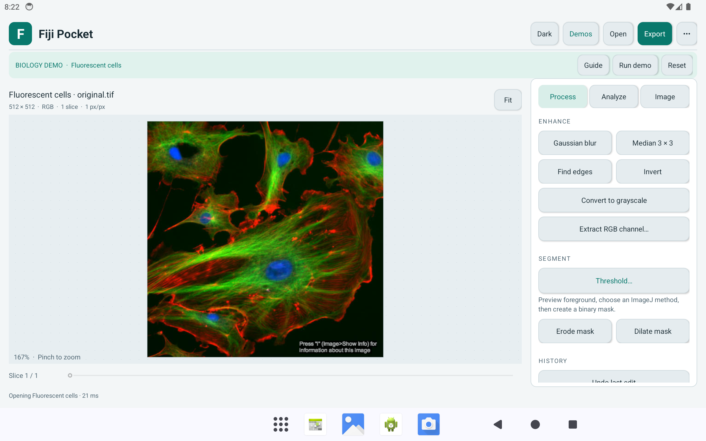
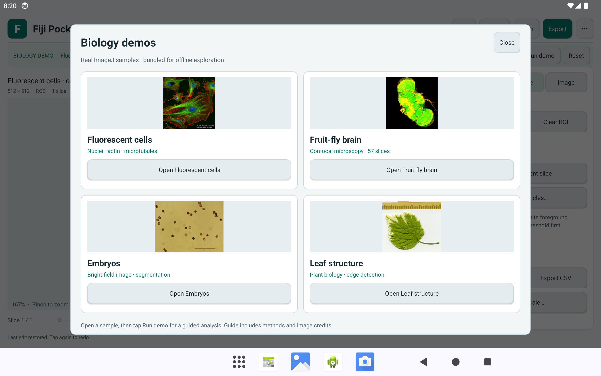

# Fiji Pocket

**Image exploration and biology demos on your Android tablet.**

Open microscopy images, try image-processing tools, and export your results.
Everything runs on your device, including four bundled biology demos.

**[Download the Android APK](https://github.com/fiosajndofoksdn/fiji-pocket/releases/latest/download/fiji-pocket.apk)** · [All releases](https://github.com/fiosajndofoksdn/fiji-pocket/releases) · [Technical reference](docs/REFERENCE.md)

Android 8.0+ · About 4.2 MB · Works offline · Light and dark themes

<picture>
  <source media="(prefers-color-scheme: dark)" srcset="docs/images/workspace-dark.png">
  
</picture>

## Install and launch

Install directly on your phone or tablet:

1. **Download.** Open the [APK download link](https://github.com/fiosajndofoksdn/fiji-pocket/releases/latest/download/fiji-pocket.apk) on your phone or tablet. Save **fiji-pocket.apk**.
2. **Open the file.** Tap the completed download, or find it in **Files → Downloads**.
3. **Install.** If Android asks for permission, tap **Settings**, enable **Allow from this source** for the browser or file manager you used, then return and tap **Install**. Button names can vary by device; see [Android's installation guide](https://support.google.com/pixelphone/answer/7391672?hl=en).
4. **Launch.** Tap **Open** after installation. Next time, tap **Fiji Pocket** in your app list.

The app opens with a sample image, so you can start immediately. After downloading,
the app and all demos work without an internet connection.

Need help installing or updating?

- **Can't find the download?** Open the [latest release](https://github.com/fiosajndofoksdn/fiji-pocket/releases/latest), expand **Assets**, and tap **fiji-pocket.apk**.
- **An additional developer-verification prompt?** See [Android's current guidance](https://support.google.com/android/answer/17588095?hl=en) for the options available on your device.
- **Updating an existing installation?** Download the newer APK from this repository and install it over the existing app. Export important work before uninstalling; uninstalling removes the app's saved workspace.
- **Still stuck?** [Open an issue](https://github.com/fiosajndofoksdn/fiji-pocket/issues) with your device model, Android version, and the message shown.

## Try your first biology demo

1. Tap **Demos** and choose **Fluorescent cells**.
2. Tap **Guide** for a short explanation, then **Run demo**.
3. Tap **Explore result** to inspect the analysis. Pinch to zoom and drag to pan.
4. Tap **Reset** to restore the original, or **Export** to save your result.

| Demo | What you'll explore |
| --- | --- |
| **Fluorescent cells** | Separate a fluorescence channel and segment bright nuclear regions. |
| **Fruit-fly brain** | Browse 57 microscopy slices and combine them into a 2D projection. |
| **Embryos** | Turn a bright-field image into a mask and label segmented regions. |
| **Leaf structure** | Find edges to reveal leaf boundaries and veins. |

These are real [ImageJ sample images](https://imagej.net/ij/images/), included in
the APK. Demo recipes are teaching examples; segmented regions are not validated
biological counts. Image credits are in each **Guide** and the [credits file](assets/demos/CREDITS.txt).

## Use your own images

Tap **Open** to choose a TIFF, PNG, JPEG, or WebP file from Android's file picker.

| Control | Use it to… |
| --- | --- |
| **Process** | Blur, find edges, extract color channels, or create a threshold mask. |
| **Analyze** | Select a rectangular region, measure pixels, or count regions in a binary mask. |
| **Image** | Adjust contrast, view a histogram, rotate, crop, or project a stack. |
| **Export** | Save image data as TIFF, the displayed image as PNG, or measurements as CSV. |
| **Light / Dark** | Switch the app's appearance; your choice is remembered. |
| **••• → Undo last edit** | Undo or redo the most recent edit. |

Use **TIFF** to preserve numerical pixel values. Processing edits apply to every
slice in a stack; measurements use the current slice. Processing keeps your
source file untouched; use **Export** to save your work.

## More about the project

Fiji Pocket is an independent Android adaptation of selected **Fiji / ImageJ**
functions. Desktop plugins, macros, Bio-Formats, and 3D viewing are outside its scope.

- [Technical reference](docs/REFERENCE.md): formats, limits, saving behavior, and demo recipes.
- [Build from source](docs/REFERENCE.md#build-from-source) · [Run the tests](docs/REFERENCE.md#reproduce-tests) · [Recorded test results](tests/verification.json).
- [GPL-3.0-or-later license](LICENSE) · [Third-party notices](THIRD_PARTY_NOTICES.txt) · [Image credits](assets/demos/CREDITS.txt).

Screenshots show version 0.3.0 on an Android tablet emulator. The workspace image
follows your GitHub light/dark preference; the app has its own theme switch.
